<div align="center">



<br/>


</div>


---

## 👨‍💻 Sobre mí

```java
public class Adri {

    String nombre = "Adrián";
    String usuario = "4driSando";
    String ubicacion = "Madrid, España";

    String estudios = "2º DAM";

    String[] intereses = {
        "Desarrollo de software",
        "Linux y servidores",
        "Docker y virtualización",
        "Desarrollo web",
        "Fútbol y videojuegos"
    };

    String objetivo = "Aprender, programar y mejorar cada día";

    public void saludar() {
        System.out.println("¡Bienvenido a mi GitHub!");
    }
}
```

---

## 🛠️ Mi stack tecnológico

<div align="center">

### 💻 Lenguajes


### ⚙️ Herramientas y tecnologías


### 🧰 Entornos de desarrollo


</div>

---

## 📊 GitHub Analytics

<div align="center">


<br/><br/>


</div>

---

## 🎯 Actualmente...

- 📚 Cursando **2º de Desarrollo de Aplicaciones Multiplataforma**.
- ☕ Profundizando en **Java y programación orientada a objetos**.
- 🐍 Mejorando mis habilidades con **Python**.
- 🐳 Aprendiendo sobre **Docker, Linux y servidores**.
- 📱 Explorando el desarrollo de aplicaciones móviles.
- 🧠 Intentando aprender algo nuevo cada día.

---

**Gracias por pasarte por mi perfil. ¡Nos vemos entre líneas de código! 🚀**


</div>
